## 概述
### 题量
10
### 分类
#### 论证类
归因论证
#### 推出类
#### 分析类

## 1.论证类
### 1.1 归因论证整体概述
归因介绍:指人们对他人或自己行为的原因的推论过程。具体的说,就是观察者对他人的行为过程或自己的行为过程所进行的因果解释和推论。

题目形式:一般由对比实验和原因分析(对策建议)或不同平常或过往的既成事实和原因分析两部分组成,有些题目会省略原因分析的过程直接给出结论或建议。

【例1】很多医学者专家提出过量饮用咖啡对健康有害。为验证过量饮用咖啡对心脏的影响,研究人员选取了两组被试者。第一组被认武者每天饮用5杯或5杯以上咖啡,第二组被试者从不饮用咖啡。一段时间后发现见,第一组被试者中患心脏病的比例明显高于第二组被试者(对比实验)。

因此,研究人员得出结论,过量饮用咖啡增加心脏病的风险(**原因分析**)。

因此,研究人员给出建议,不要过量饮用咖啡(**给出建议**)。

【例2】许多大城市的中小学校门口,在每天早晚交通高峰期,都能看到接送孩子的车队长龙(**不同平常的既成事实**)。有人认为,开车接送孩子上学是导致交通严重拥堵的原因(**原因分析**)。

归因论证可分为实验对比归因（实验组和参照组）、时间对比归因（现在和过去）、一般归因、直接根本原因(特殊题型)。

质疑方式:常见有另有他因、因果倒置、否定此因三种。

支持方式:常见有排除他因、解释说明等。

## 1.2对比实验归因
### 1.2.1 另有他因质疑
另有他因指的是在题干认为的原有原因之外,增加一个也可能导致结果的原因,从而**降低**原有原因成立的可能性。

另有他因选项往往只是"将水搅混",而**并非完全否定**原有原因。

【例】某位讲师不喜欢运动,并且很胖。因此,不爱运动会导致长胖。

以下哪项如果为真,最能前弱上述观点:

A.暴饮暴食也会导致长胖（没有回归到实验，并且用了也，没有削弱）

B.该讲师还有暴饮暴食的习惯（讲师不变，暴饮暴食和不爱运动是变量）

底层逻辑：题干是通过实验得出的结论!要质疑他,就要**回归到实验**中,找他实验的毛病!**没回归到实验，就是伪他因**

要让实验成立，就要控制变量唯一

我上岸了!!是因为我很努力!

你是因为太聪明!!!!----直接反对努力

智商也影响考试结果!----二者并行

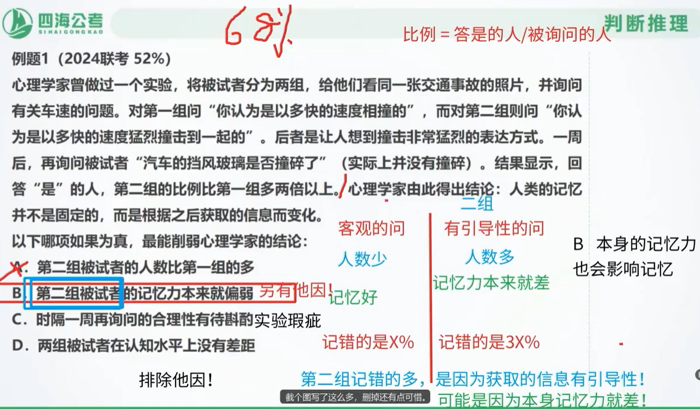

B：另有他因；C：实验瑕疵；D：排除他因，支持

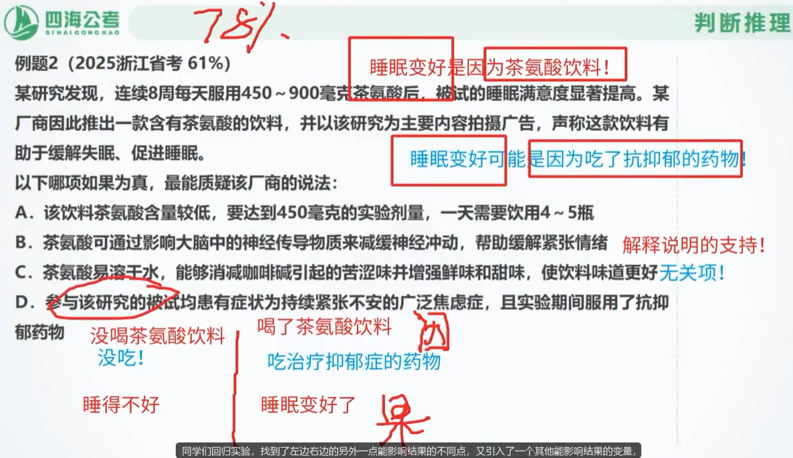

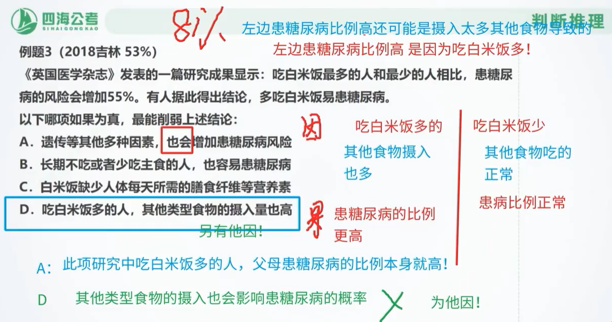

A：未回归实验；B：没回归实验；C：话题不一致

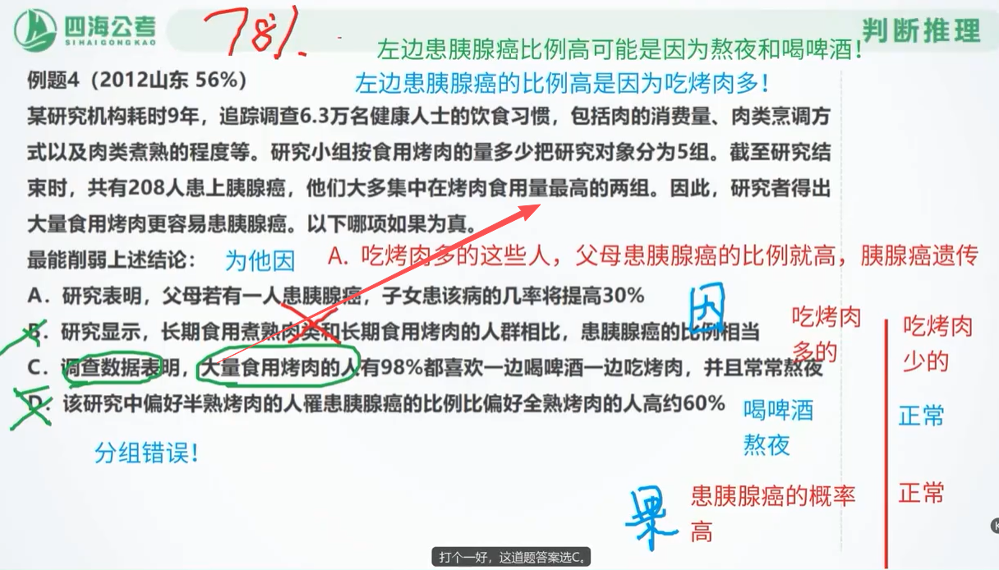

A：未回归实验；C：回归实验了

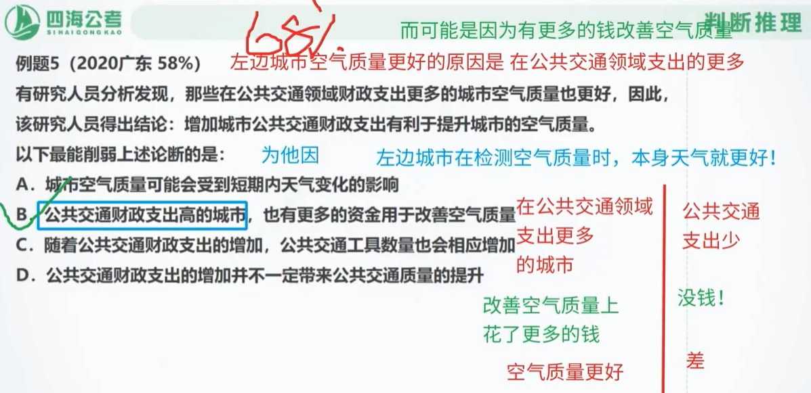

#### 1.2.1.1"继发关联"的另有他因
继发关联是指疾病A与疾病B并不存在因果关系,而是由于两者(A和B)有共同的原因C而产生的关联。

归因论证中的"继发关联"指的是,A与B不存在因果关联,A与B均是其共同原因C导致的结果。

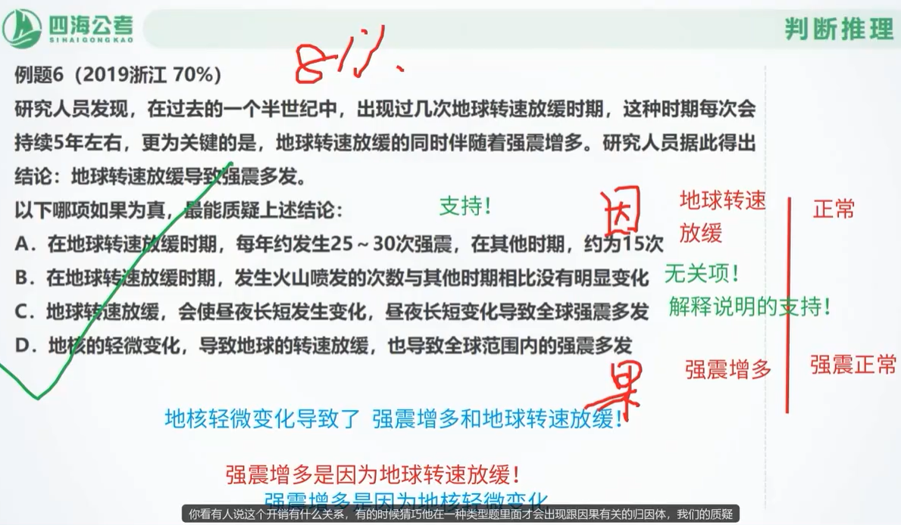

A：支持，但只是既成事实；B：无关；C：转速放缓——>昼夜长短变化——>强震多发，解释说明，支持；D：地核变化导致的二者。

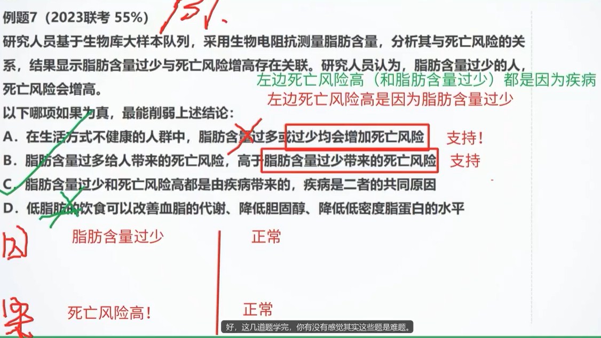

#### 1.2.1.2利用分组正确找到另有他因选项
题干中有多种实验分组方式时,根据最终的结论确定实验组和对照组,并根据正确的分组找出另有他因选项。

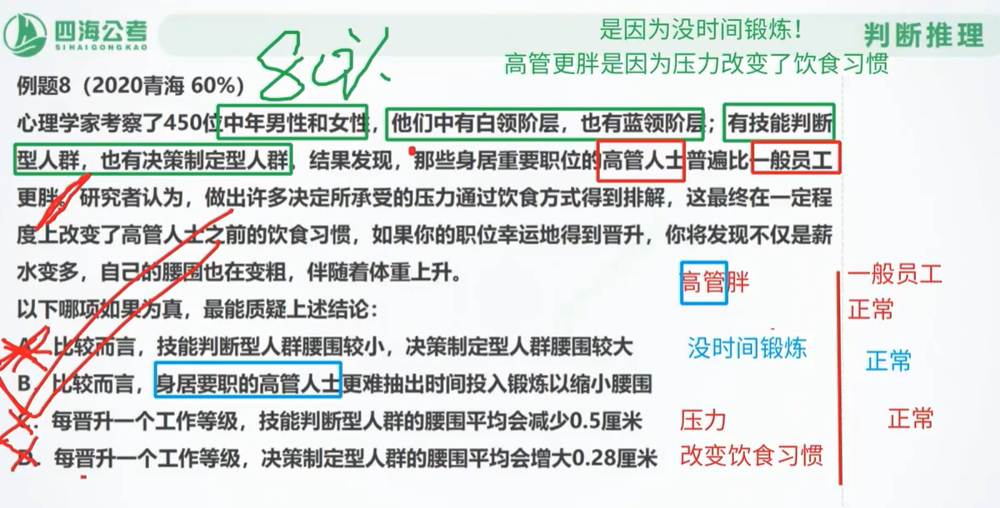

A：把技能判断等同于员工，决策制定等同于高管，分类不对；C、D：都在说既定事实，没有分析原因。

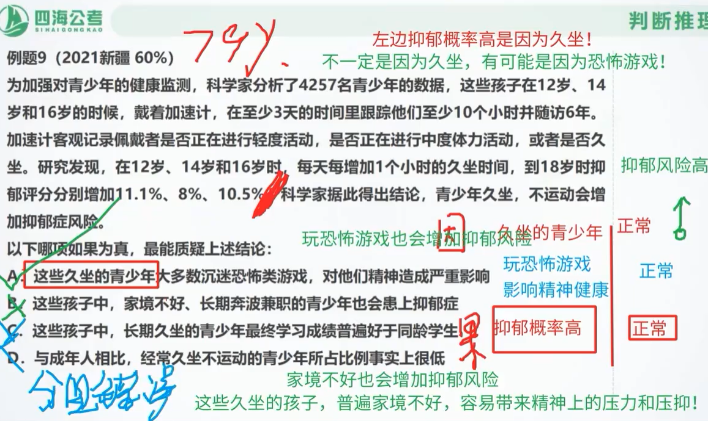

因：久坐；果：抑郁概率高

A：另有他因；B：分组不对，对比不强烈；C：话题不一致；D：分组错误

A改造为伪他因：玩恐怖游戏也会增加抑郁风险；

B改造为伪他因：家境不好也会增加抑郁风险

B改为正确他因：这些久坐孩子普遍家境不好，容易带来精神上的压力和压抑。

### 1.2.2 因果倒置质疑
因果倒置是一种在相对确定的条件下把原因和结果相互颠倒,视结果为原因和视原因为结果而引起的谬误。

【例】所有迈阿密电力公司的高级官员都拥有大的游艇,因此如果你想成为迈阿密电力公司的高级官员的话,你最好有一艘大一点的游艇。

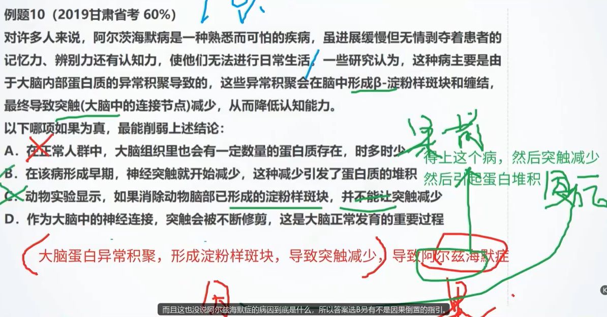

因：大脑蛋白异常积聚，斑块和缠结，突触减少；果：阿尔兹海默症；

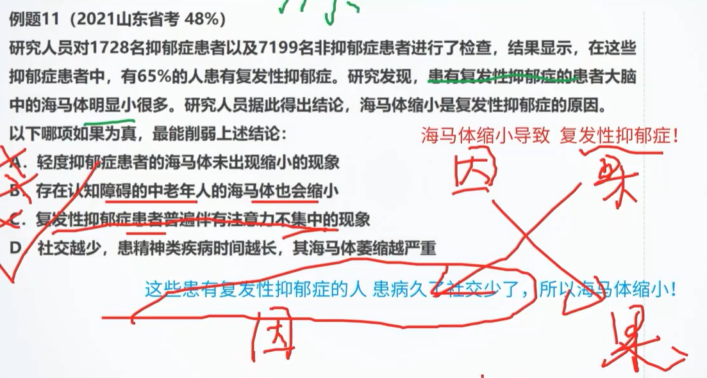

因：海马体缩小；果：复发性抑郁症

